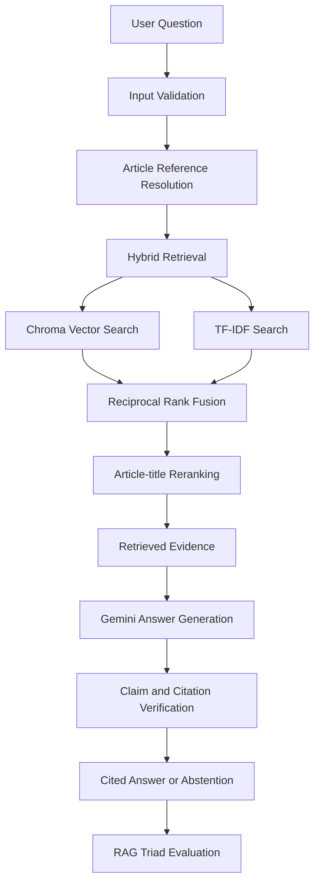

# RAGTrust Lab

### Evidence-grounded RAG with hallucination checks, layered guardrails, and measurable evaluation.

RAGTrust Lab is a Python-based Retrieval-Augmented Generation (RAG) application for asking questions about the **Constitution of Nepal**.

The system combines hybrid retrieval, Google Gemini, citation verification, claim-level grounding checks, five-layer guardrails, and RAG evaluation.

It was developed as a hands-on AI Engineering project to explore a central challenge in LLM applications:

**How can a RAG system retrieve relevant evidence, generate supported answers, and measure its own reliability?**

> **Status:** Functional English-language MVP · Educational and research demonstration

> **Important:** This application is not a source of current or verified legal advice. Its built-in English Constitution document incorporates amendments through 2020; later changes have not been verified.

---

## Overview

Unlike a basic PDF chatbot, RAGTrust Lab combines retrieval, grounded generation, verification, and evaluation in one workflow.

### Core Capabilities

| Area | Implementation |
| :--- | :--- |
| Document Processing | Article-aware Constitution extraction and chunking |
| Semantic Retrieval | Chroma + Sentence Transformers |
| Keyword Retrieval | TF-IDF |
| Retrieval Fusion | Reciprocal Rank Fusion (RRF) |
| Reranking | Article-title-aware reranking |
| Answer Generation | Google Gemini |
| Hallucination Checks | Claim-level evidence and citation verification |
| Guardrails | Five-layer input, retrieval, and output safeguards |
| Evaluation | RAG Triad, retrieval metrics, and abstention testing |
| User Interface | Streamlit |

The built-in Constitution workflow is designed around **308 constitutional articles** extracted from the project's English source PDF.

---

## System Architecture



The architecture separates retrieval, generation, verification, and evaluation so that each stage can be analysed independently.

---

## Retrieval Engineering

### Hybrid Search

RAGTrust Lab combines two retrieval approaches:

**Dense Semantic Retrieval**

Uses local sentence embeddings and Chroma to identify passages related to the meaning of a question.

**TF-IDF Retrieval**

Uses lexical matching to identify exact terms, constitutional article references, and relevant keywords.

### Rank Fusion and Reranking

The system applies:

1. Reciprocal Rank Fusion to combine semantic and keyword retrieval results.
2. Article-title reranking to improve alignment with constitutional provisions.
3. Article-aware chunking to retain article identity and source metadata.

The combination is intended to improve retrieval across both natural-language questions and explicit article references.

---

## Hallucination Checks and Guardrails

The application implements five layers of safeguards.

| Layer | Responsibility |
| :--- | :--- |
| **G1** | Input validation and basic safety checks |
| **G2** | Document-restricted retrieval and article-reference validation |
| **G3** | Treat retrieved material as untrusted evidence |
| **G4** | Structured answer generation using retrieved context |
| **G5** | Citation validation and claim-level verification |

### Claim Verification

Generated answers are checked against retrieved evidence.

The verification workflow examines supporting passages and citations to identify claims that may not be adequately grounded.

When sufficient evidence is unavailable, the system is designed to abstain rather than provide an unsupported answer.

These safeguards reduce certain risks but do not guarantee that every response is accurate or free from hallucinations.

---

## RAG Evaluation

RAGTrust Lab includes evaluation workflows for retrieval quality, answer grounding, and abstention behaviour.

### RAG Triad

Three dimensions are evaluated:

| Dimension | Question |
| :--- | :--- |
| Context Relevance | Did retrieval find evidence relevant to the question? |
| Groundedness | Are generated claims supported by the retrieved evidence? |
| Answer Relevance | Does the response address the user's question? |

Triad scores are model-based estimates and should not be interpreted as guarantees of factual correctness.

### Retrieval Metrics

The evaluation dashboard includes:

- Article Hit@K
- Article Precision@K
- Article Recall@K
- Page-based retrieval evaluation
- Abstention evaluation
- End-to-end answer evaluation

### Golden Dataset

The current Constitution evaluation dataset contains 13 questions:

| Category | Questions |
| :--- | ---: |
| Answerable | 11 |
| Unanswerable | 2 |
| **Total** | **13** |

The dataset is a small development benchmark with provisional labels. Broader, independently reviewed data would be needed for more reliable evaluation.

### Reported Development Tests

The original project documentation records the following local test results:

| Test | Reported Result |
| :--- | :--- |
| Article extraction | 308/308 |
| Explicit article retrieval | 11/11 |
| Natural-language retrieval | 9/9 |
| Multi-article retrieval | 5/5 |
| Article reference formats | 6/6 |
| Abstention cases | 2/2 |
| Automated pytest suite | 26/26 |

These results reflect the documented development test cases, not an independent verification or a claim of perfect performance.

---

## Technology Stack

**Programming and Application**

- Python 3.12+
- Streamlit
- LangChain
- Pydantic

**Retrieval and Document Processing**

- Chroma
- Sentence Transformers
- Scikit-learn
- PyPDF

**LLM and Evaluation**

- Google Gemini
- Custom citation and claim-verification workflows
- RAG Triad evaluation
- Pandas and NumPy

**Development**

- uv
- pytest
- Git

---

## Getting Started

### Prerequisites

- Python 3.12 or newer
- `uv` package manager
- Gemini API key
- Internet connection for Gemini requests and initial model downloads

### 1. Clone the Repository

```bash
git clone https://github.com/GaneshPokharel-tech/ragtrust-lab.git
cd ragtrust-lab
```

### 2. Install Dependencies

```bash
uv sync
```

### 3. Configure Environment Variables

Create a `.env` file in the project root.

```env
GEMINI_API_KEY=your_gemini_api_key
```

Never commit real credentials or API keys.

### 4. Prepare the Source Document

For the built-in Constitution workflow, place the supported English Constitution PDF at:

```text
data/constitution/constitution_en.pdf
```

The article-aware parser is tailored to the specific English document used during development.

Different document editions may require additional validation or parser changes.

### 5. Start the Application

```bash
uv run streamlit run src/app.py
```

Open the local URL displayed by Streamlit.

---

## Example Questions

**Direct Article Lookup**

```text
What does Article 18 say about the right to equality?
```

**Natural-Language Retrieval**

```text
What constitutional protection exists against censorship of news?
```

**Multi-Article Comparison**

```text
Compare Article 18 and Article 38 of the Constitution of Nepal.
```

**Abstention Testing**

```text
What does Article 400 of the Constitution of Nepal state?
```

The final example is intended to test how the system handles an unsupported constitutional article reference.

---

## Running Tests

Run the automated test suite:

```bash
uv run python -m pytest -q
```

Evaluation experiments can also be conducted through the Streamlit evaluation dashboard.

Some evaluation operations call Gemini and may consume API quota.

---

## Project Structure

```text
ragtrust-lab/
│
├── src/
│   ├── app.py
│   ├── rag.py
│   ├── scoring.py
│   ├── safety.py
│   └── evaluation.py
│
├── data/
│   ├── constitution/
│   ├── golden_constitution.json
│   └── golden_rag_triad.json
│
├── tests/
│   └── test_core.py
│
├── .env.example
├── pyproject.toml
├── uv.lock
└── README.md
```

### Component Responsibilities

| File | Purpose |
| :--- | :--- |
| `app.py` | Streamlit interface and application workflows |
| `rag.py` | Document ingestion, indexing, and retrieval |
| `scoring.py` | Answer generation, verification, and RAG Triad |
| `safety.py` | Input and output safeguards |
| `evaluation.py` | Retrieval and abstention evaluation |
| `test_core.py` | Automated regression tests |

---

## Current Limitations

- The built-in Constitution source is not verified against amendments after 2020.
- The MVP primarily supports English-language interactions.
- Article-aware extraction is tailored to the project's English Constitution PDF.
- OCR for scanned PDFs is not implemented.
- Some citations represent article page ranges rather than exact quotation locations.
- Retrieval parameters require further calibration.
- The golden dataset is limited and needs expert-reviewed expansion.
- Vector indexes are held in memory rather than persistent production storage.
- Authentication and multi-user isolation are not production-ready.
- Gemini processes supplied document passages during answer generation.
- Evaluation scores are not substitutes for independent factual or legal review.

---

## Future Improvements

Potential directions include:

- Nepali-language support
- Multilingual retrieval
- Larger expert-reviewed evaluation datasets
- Improved citation precision
- Persistent vector storage
- Additional document-version support
- Authentication and multi-user access
- Evaluation monitoring and reporting

These are planned improvements, not claims about the current implementation.

---

## Technical Documentation

For detailed implementation notes, evaluation results, source citations, safeguards, and design decisions:

[Read the technical documentation](docs/technical-documentation.md)

---

## Author

**Ganesh Pokharel**

AI Engineer | Python Developer

[GitHub](https://github.com/GaneshPokharel-tech) · [LinkedIn](https://www.linkedin.com/in/ganesh-pokharel-30786b192/)

---

*An educational AI Engineering project exploring retrieval reliability, grounded generation, and measurable RAG evaluation.*
